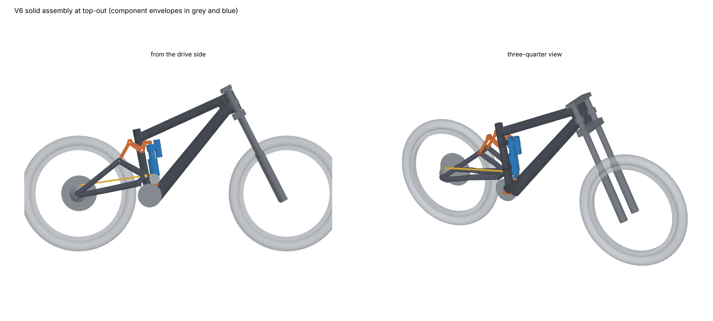
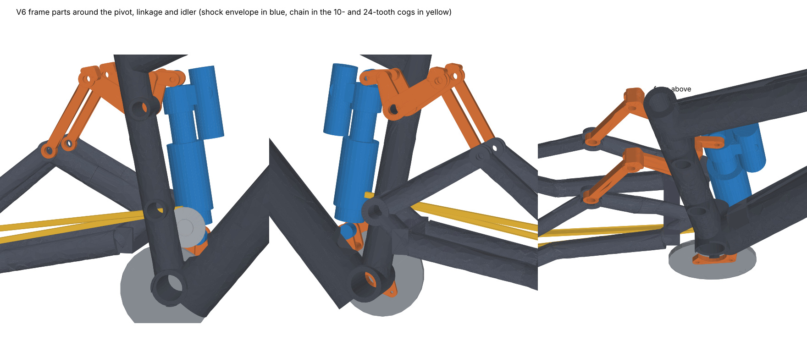
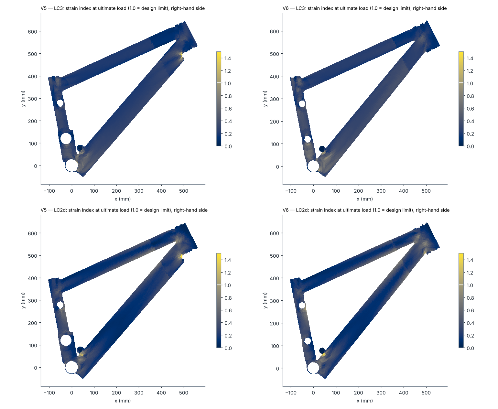
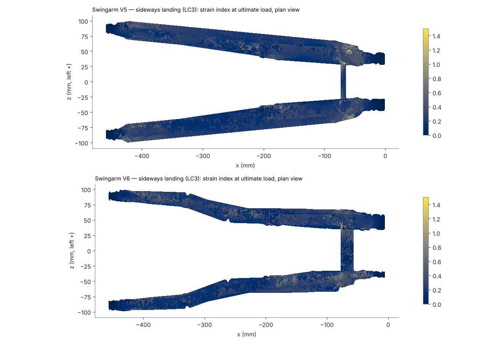

# V6: the frame as a 3-D assembly

**Status: a detailed design, still on paper.** V6 is the first revision that exists as solid parts in one assembly, checked for clashes through the whole suspension travel and steering range, analysed again on the changed geometry, and documented for a prototype shop. It has **not** been built, tested, or reviewed by a qualified composite-structures engineer. It is not safe to ride.

Labels as in the main report: **measured**, **simulated**, **calculated**, **estimated**, **unknown**. Coordinates: origin at the BB centre, x forward, y up, z to the rider's left, millimetres, suspension extended.

## 1. What changed in one paragraph

The hard points, geometry and suspension curve are those of V5. Everything around them changed, because V5 had only been checked in side view. Putting real component envelopes into a 3-D assembly showed ten clashes or impossibilities (section 2). Fixing them made the swingarm narrower than the analysis had assumed, and checking that exposed an error in my own structural model (section 3). After a redesign the result is: front-triangle worst strain index **0.82** (up to 0.93 across mesh sizes), swingarm **0.69**, lowest joint margin **+17%**, no clash anywhere in the travel and steering sweep, and a frame mass of **4.77 kg** (V5: 4.61 kg). Against the three goals the picture is the same as for V5, except that the mass figure moved the wrong way (section 9).

## 2. What the 3-D check found wrong with V5

| # | Finding | Why V5 missed it | Change in V6 |
|---|---|---|---|
| 1 | The bulge of the BB core sat where the shock's air can has to be | side view only; the core was an analysis primitive | bulge removed; the lower seat mast widens toward the BB instead (72 mm at the BB, 52 mm above the pivot) |
| 2 | The down tube's underside hung below the bottom of the head tube, in the path of the fork's lower crown | fork not modelled | down tube meets the head tube 62 mm up from its lower end (was 38) and tapers from 82 to 68 mm deep |
| 3 | The shock's reservoir does not fit at the frame end | RockShox publish the reservoir envelope only in a fit drawing; V5 used a plain cylinder | shock turned round: air can at the frame, damper head and reservoir at the rocker, reservoir facing forward into the open triangle |
| 4 | Carbon tabs for the lower shock mount cannot be laid up in the space left | no solid model | 7075 fitting SM-001 seated in a pocket in the down-tube junction, bolted (2 × M6) and bonded; the shock load goes into the pocket floor in bearing |
| 5 | A rocker straddling the seat mast collides with the damper head | no solid model | two rocker plates run outside the mast and step inward ahead of it; they clamp a 17 mm axle that turns in two bushes inside the mast |
| 6 | Swingarm spars passed through the brake rotor and cassette near the axle | spars were drawn 86 mm out but 22–30 mm wide with no rotor or cassette | spars leave the dropouts outboard of the hub ends and only come inboard ahead of the rotor |
| 7 | The chain ran through the upper spar, the yoke and the upright | chain not modelled | lower spar kept below the chain in every gear; on the drive side the upright and pivot eye stay inboard of the chain where it crosses them |
| 8 | The crank-arm envelope I had assumed was far too narrow | placeholder instead of the manufacturer's drawing | SRAM's frame-fit profile for X01 DH cranks; the swingarm stays at least 6 mm inside it |
| 9 | The idler had nothing to stand on: the chain passes over the pivot axis, so nothing can be mounted there outboard of the swingarm eye | idler drawn as a point | idler on an 8 mm plate (ID-003) bolted to ISCG 05 tabs that are part of the BB sleeve (BB-001); idler centre moved to (30.0, 100.5) |
| 10 | Crowns: the head tube and headset need 141.9 mm between the fork crowns | not checked | inside the BoXXer's Tall-crown range (126.8–147 mm); the Short crown does not fit |

## 3. What checking the swingarm found wrong with my analysis

Three errors, all mine, all found in this revision. They matter more than any clash.

1. **The shell model sat on the wrong surface.** In V1–V5 the shell elements were placed on the modelled surface and given the laminate's thickness, half of it outside that surface. Once the solid model is the tool surface, the laminate lies wholly inside it, so the analysed sections were too big by one wall thickness. For wide tubes that is a few percent. For the narrow swingarm members it is not: the first packaged V6 swingarm scored 0.75 with the shell on the surface and **1.24** with the shell on the true mid-plane (limit 1.00), and its lateral stiffness fell from 408 to 208 N/mm. The head tube went from 0.75 to **1.03**: with a 55.9 mm headset bore, the 66 mm tube I had analysed could not have had the wall I had given it (simulated).
2. **The mid-plane was then placed too deep in flat sections**, because the distance function I used for elliptical tubes is exact only across the narrow direction. Replaced with a first-order-accurate one (mean error 0.1 mm against brute force).
3. **A waypoint added to one spar broke the model.** Tube segments have square ends, so a bend in a spar leaves a notch. One such notch on the drive-side strut made the result three times worse than the same strut without the waypoint. I removed the waypoint. The remaining bends are gentle, but this is a weakness of how the geometry is built, and section 8 lists it.

**What this means for V1–V5.** Their numbers describe parts whose outside is half a wall thickness larger than the surfaces in `cad/*_V5.stl`. They remain a fair record of the idealised study, but V5 is not a buildable design and its swingarm would not have fitted the bike.

**The redesign that followed.**

- Swingarm made **asymmetric**. The drive side is boxed in between the seat mast and the chain at the pivot (15.5 mm of width). The non-drive side has no chain, so its pivot eye is 31 mm wide and its upright and strut are 26–31 mm wide.
- Lower spars widened to 27–31 mm where the tyre and crank allow; upper spars to 20–22 mm; the yoke lengthened from 20 to 26 mm; the strut now continues the lower spar's line into the pivot eye.
- Swingarm laminate: spars 22 plies (3.48 mm), pivot eyes, lugs and dropouts 32 plies (5.00 mm), yoke junction 36 plies (5.60 mm).
- Head tube 70.8 mm outside diameter with a 7.4 mm wall (48 plies). Rocker boss enlarged to hold its bush sleeve.
- An asymmetric swingarm has to take the side load from either side, so the sideways landing is now run both ways (LC3 and LC3m).

## 4. Parts

| Part | Description | Qty | Material | Mass each (g) | Mass basis | Status |
|---|---|---|---|---|---|---|
| FT-001 | Front triangle (head tube, top tube, down tube, seat mast, BB and pivot bosses) | 1 | Toray T700G/2510 UD + T700S/2510 plain weave prepreg | 2131 | model + 8 % overlaps | analysed; tool surface needs production surfacing |
| SA-001 | Swingarm, asymmetric (wide non-drive pivot eye) | 1 | same prepregs | 1020 | model + 8 % overlaps | analysed; drive-side pivot lug needs solid-element analysis or test |
| BB-001 | Bottom-bracket sleeve, 83 mm, BSA thread 1.37 in x 24 TPI, with integral ISCG 05 tabs | 1 | 7075-T6, hard anodised | 111 | model | modelled; tab face offset to be confirmed against the chain guide |
| FT-INS-02 | Main pivot sleeve, 26 OD x 20 H7 bore x 58 | 1 | 7075-T6, hard anodised | 35 | calculated | sized, not drawn |
| FT-INS-03 | Rocker bush sleeve, 24 OD x 19 H7 bore x 62 | 1 | 7075-T6, hard anodised | 29 | calculated | sized, not drawn |
| SM-001 | Shock-mount fitting (air-can end of the shock), 30 mm between ears, M8 | 1 | 7075-T6, hard anodised | 116 | model | modelled; bolt inserts not drawn |
| SA-INS-01 | Dropout inserts, 157 mm spacing, drive side to the SRAM UDH specification | 2 | 7075-T6, hard anodised | 38 | estimate | not drawn; must be checked against SRAM's STEP clearance model |
| SA-INS-02 | Pivot bush sleeves, 27 OD x 23 H7 bore (15.5 long drive side, 31 long non-drive side) | 2 | 7075-T6, hard anodised | 10 | calculated (average) | sized, not drawn |
| SA-INS-03 | Rear brake post-mount bosses, 2 x M6, 74.2 mm spacing | 2 | 7075-T6, hard anodised | 9 | estimate | OPEN: position and caliper clearance not designed |
| RK-001 | Rocker plates, left and right | 2 | 7075-T6, hard anodised | 139 | model (not pocketed) | modelled; pocketing and fatigue check outstanding |
| LK-001 | Push link, 16 x 11 section, about 130 mm between eyes | 2 | 7075-T6, hard anodised | 72 | model | modelled |
| AX-001 | Main pivot axle, 20 OD x 14 bore x 113.5 (longer on the non-drive side) | 1 | Ti-6Al-4V (grade 5), annealed | 81 | model | modelled; end bolts not drawn |
| AX-002 | Rocker axle, 17 OD x 11 bore x 90, clamps the two rocker plates | 1 | Ti-6Al-4V (grade 5), annealed | 53 | model | modelled; end bolts not drawn |
| PIN-12 | Link pins, 12 f7 | 4 | Ti-6Al-4V (grade 5), annealed | 16 | estimate | sized, not drawn |
| ID-001 | Idler sprocket, 14 teeth, narrow-wide, with sealed bearing | 1 | 7075-T6 or steel | 46 | model + bearing estimate | envelope only; bearing not selected |
| ID-002 | Idler stub, 16 mm shoulder, M12 into the carrier | 1 | Ti-6Al-4V (grade 5), annealed | 16 | model | modelled |
| ID-003 | Idler carrier plate, 8 mm, on the three ISCG 05 tabs | 1 | 7075-T6, hard anodised | 100 | model (not pocketed) | modelled; outline indicative, lower chain guide not designed |
| BUSH | GGB DU plain bushes: 2 x 1720DU, 1 x 2015DU, 1 x 2030DU, 4 x 1210DU | 1 | steel-backed PTFE (GGB DU) | 60 | estimate (set) | sizes exist in the catalogue; life not assessed |
| HW | Bolts and washers: 2 x M8 shock bolts, 3 x M6 ISCG bolts, 2 x M6 fitting bolts, axle end bolts, thrust washers | 1 | class 12.9 steel / Ti | 120 | estimate (set) |  |
| PROT | Down-tube guard, spar and chain protection, fork bump-stop pads, paint | 1 | moulded rubber / PU film / paint | 250 | estimate (set) | not designed |
| | **Frame mass by the goal G2 definition** | | | **4768** | ±12 % → 4.20–5.34 kg | |

Bought-in and not counted: RockShox 8 x 30 shock hardware x 2; Cane Creek Forty ZS56/ZS56 headset (or +/-5 mm reach cups); SRAM DUB BSA 83 BB; SRAM UDH; 12 x 157 rear axle; 31.6 mm seat post and clamp.

Why metal where it is metal: pivots, pins and bolted seats need hard, accurate, wear-resistant surfaces and threads, which laminate cannot give. Each aluminium part is isolated from the carbon by a glass ply (galvanic corrosion). Bushes instead of ball bearings because the main pivot sees 15.5 kN per side at limit load, three times the static rating of a ball bearing that would fit.

## 5. Geometry and suspension

Unchanged from V5: reach 475 mm, stack 632.5 mm, head angle 63.0°, rear centre 440 mm, wheelbase 1281 mm, 200 mm rear travel, leverage ratio 3.48 → 2.17, 229 psi at 25 % sag with 2 tokens. The goal-G1 numbers are therefore the same as V5's.

The idler moved, which changes the chain effects (calculated, at sag, 32-tooth ring and 17-tooth cog):

| | V5 | V6 |
|---|---|---|
| Idler centre | (-54.0, 92.0) | (30.0, 100.5) |
| Anti-squat | 126 % | 117 % |
| Anti-rise | 134 % | 134 % |
| Change in length of the upper chain run, top−out to bottom−out | +0.4 mm | −5.2 mm (the run gets shorter, so the suspension does not pull on the pedals; the derailleur takes up the slack) |
| Gap between idler teeth and chainring teeth | not checked | 4.8 mm with a 32-tooth ring; 0.8 mm with 34, so 32 is the largest ring |

## 6. Clearances measured on the solid model

Minimum distance between solids over nine travel positions (0 to 200 mm in 25 mm steps), and for the fork at 0, 20 and 40° of steering at both ends of its travel (calculated on the solid model). Designed joints are excluded inside a small radius around the joint axis. The right-hand column says how good the other part's envelope is.

| Pair | Minimum (mm) | Where | My rule (mm) | Verdict | Envelope of the other part |
|---|---|---|---|---|---|
| Rear tyre to swingarm | 6.0 | fixed | 6 | ok | 64 mm wide, 712 mm diameter tyre: nominal size, estimated |
| Rear tyre to seat mast | 11.5 | at 200 mm travel | 6 | ok | as above |
| Chain in the 24-tooth cog to swingarm | 3.9 | at 0 mm travel | 4 | marginal | cog positions estimated; chain envelope 8.2 × 8.8 mm |
| Chain in the 10-tooth cog to swingarm | 4.4 | at 0 mm travel | 4 | ok | as above |
| Chain on the 32-tooth ring to swingarm | 5.1 | at 0 mm travel | 5 | ok | SRAM chainring radius |
| Crank arms to swingarm | 6.3 | at 0 mm travel | 5 | ok | SRAM X01 DH frame-fit profile less 1.5 mm for crank boots |
| Cassette to swingarm | 3.9 | fixed | 3 | ok | cog positions estimated |
| 220 mm rotor to swingarm | 4.9 | fixed | 3 | ok | rotor plane estimated |
| Swingarm to front triangle | 5.8 | at 200 mm travel | 4 | ok | both modelled |
| Rocker to front triangle | 4.3 | at 0 mm travel | 4 | ok | both modelled |
| Push links to swingarm | 6.3 | at 0 mm travel | 4 | ok | both modelled |
| Push links to front triangle | 15.5 | at 150 mm travel | 4 | ok | both modelled |
| Shock to front triangle | 5.7 | at 0 mm travel | 4 | ok | RockShox fit drawing for the 2024 Vivid; **no drawing exists for the 2027 shock** |
| Shock to rocker | 5.0 | at 75 mm travel | 4 | ok | as above; damper-head size estimated |
| Shock to swingarm | 17.3 | at 0 mm travel | 4 | ok | as above |
| Shock to idler and its carrier | 12.9 | top-out | 4 | ok | as above |
| Idler carrier to the chain on the ring | 2.9 | fixed | 3 | marginal | SRAM chainline and ring position |
| Idler carrier to crank arm | 13.7 | fixed | 5 | ok | SRAM profile |
| Idler teeth to chainring teeth | 4.8 | fixed | 4 | ok | calculated from tooth radii |
| Fork crowns and upper tubes to frame, steering 0–20° | 6.0 | any fork travel | 4 | ok | **crown outline and stanchion spacing estimated**; RockShox do not publish them |
| Front tyre to down tube, fork bottomed | 34.1 | 200 mm fork travel | 6 | ok | nominal tyre |

- The push links run with 1.0 mm on each side inside the rocker's clevis: that is a designed running fit for thrust washers, not a clearance.
- At 40° of steering the fork's bump stops are 1.1 mm from the frame, so steering lock is about 40° each way and the frame needs pads where they land. The fork dimensions behind that number are estimates.
- Anything within about a millimetre of its rule, and anything resting on an estimated envelope, has to be confirmed with the real parts in hand.
- The analysed surface and the solid model are built from the same primitives but joined differently (smooth blends against plain unions). Median gap between them 0.5 mm, 99 % within 2.3 mm, largest 10 mm at junctions and at the pockets for the shock fitting and BB flange, which the analysis does not have.

## 7. Structure

Same loads, limits and method as section 5 of `REPORT.md`, with the corrections of section 3: shell meshes on the laminate mid-plane; sideways landing from both sides for the swingarm.

| Case | Front triangle: governing zone | Index | Mode | Swingarm: governing zone | Index | Mode |
|---|---|---|---|---|---|---|
| LC1 Hard braking into a compression | down_tube | 0.30 | fibre compression | knee | 0.12 | transverse tension (matrix) |
| LC2a Bottom-out landing, rider centred | down_tube | 0.65 | fibre compression | yoke | 0.37 | transverse tension (matrix) |
| LC2b Bottom-out landing, weight back | down_tube | 0.70 | fibre compression | yoke | 0.41 | transverse tension (matrix) |
| LC2c Bottom-out landing, weight forward | boss | 0.73 | transverse tension (matrix) | yoke | 0.41 | transverse tension (matrix) |
| LC2d Front wheel cases a knuckle | ht_junction | 0.82 | fibre compression | node | 0.29 | fibre compression |
| LC3 Sideways landing | boss | 0.81 | fibre compression | node | 0.69 | fibre compression |
| LC4 Cornering compression | core | 0.26 | fibre compression | yoke | 0.27 | transverse tension (matrix) |
| LC3m Sideways landing, from the other side | (symmetric part: same as LC3) | |  | yoke | 0.60 | fibre compression |

Index = largest ply strain ÷ design limit at 1.5 × limit load, patch-averaged at the hot spot (simulated). 1.00 or less passes.

In these two figures the V5 panels come from the uncorrected model (shell on the modelled surface) and the V6 panels from the corrected one, so they show where the strain sits, not a like-for-like improvement.

**Mesh check (simulated).** Governing index by case at three element sizes:

| Part | Element size | Nodes | LC1 | LC2a | LC2b | LC2c | LC2d | LC3 | LC4 | Laminate (kg) |
|---|---|---|---|---|---|---|---|---|---|---|
| Front triangle | 7.0 mm | 7602 | 0.27 | 0.66 | 0.80 | 0.75 | 0.89 | 0.77 | 0.26 | 1.964 |
| Front triangle | 6.0 mm | 10495 | 0.30 | 0.65 | 0.70 | 0.73 | 0.82 | 0.81 | 0.26 | 1.973 |
| Front triangle | 4.5 mm | 18593 | 0.30 | 0.65 | 0.70 | 0.73 | 0.93 | 0.74 | 0.26 | 1.987 |

| Part | Element size | Nodes | LC1 | LC2a | LC2b | LC2c | LC2d | LC3 | LC4 | LC3m | Lateral stiffness (N/mm) |
|---|---|---|---|---|---|---|---|---|---|---|---|
| Swingarm | 5.0 mm | 6810 | 0.12 | 0.41 | 0.45 | 0.45 | 0.35 | 0.65 | 0.25 | 0.65 | 422 |
| Swingarm | 4.0 mm | 11158 | 0.12 | 0.37 | 0.41 | 0.41 | 0.29 | 0.69 | 0.27 | 0.60 | 407 |
| Swingarm | 3.3 mm | 16150 | 0.12 | 0.39 | 0.43 | 0.43 | 0.30 | 0.69 | 0.27 | 0.69 | 397 |

The values move by up to 0.10 (front triangle) and 0.09 (swingarm) between meshes without a clear trend: that is the numerical noise of the hot-spot measure. Read the front triangle's worst case as **0.93** and the swingarm's as **0.69**, not as the single values in the table above. At the finest mesh the front triangle's worst point is on the seat mast beside the rocker boss, where the rocker's 36 kN reaction enters through a rigid ring in the model. A local pad of six extra plies there barely moved it (0.93 to 0.91) and raised another case, so I left it out. The margin there is thin, and that joint is the first thing a detailed analysis or a test should look at.

**Buckling (simulated).** Lowest linear buckling load ÷ ultimate load: front_triangle (h=6): LC2b 17.2, LC2c 16.6, LC2d 9.2, LC3 6.7; swingarm (h=4): LC2b 12.2, LC3 17.1, LC3m 17.8. Smallest 6.7; anything above about 2 leaves room for the usual knock-down on linear shell buckling.

**Joints and hardware at ultimate load (calculated).**

| Check | Demand | Capacity | Unit | Margin | Basis |
|---|---|---|---|---|---|
| Shock hardware, bending (12.7 mm pin with the M8 bolt through it, treated as one solid steel section) | 855 | 1000 | MPa | +17% | calculated; simply supported, load spread over a 22 mm eyelet (eyelet width estimated); pin and bolt strength unverified |
| ID-003 carrier plate, bending out of its plane (8 mm 7075, about 30 mm wide at the idler, 11 mm offset) | 387 | 503 | MPa | +30% | estimated |
| ID-003 ISCG bolts M6 class 12.9, shear (direct share plus the moment about the BB over a 73 mm bolt circle) | 7853 | 12591 | N | +60% | estimated; statics of the two chain runs, 24-tooth cog; sprint load of 2.0 kN on one pedal; direct and moment shares added arithmetically |
| Link bushes GGB 1210DU, pressure at limit (12 x 10 mm) | 86 | 140 | MPa | +62% | calculated; dynamic rating |
| Shock bolt M8, double shear | 297 | 626 | MPa | +111% | calculated; ignores the clamped pin, which shares the shear |
| Dropout insert bond shear (3600 mm2 each, also wrapped by the spar laminate) | 2 | 5 | MPa | +112% | estimated; average shear |
| AX-001 main pivot axle, bending at the frame sleeve (20/14 mm Ti, drive-side arm 9.75 mm) | 379 | 880 | MPa | +132% | calculated; per-side force with the side-load couple taken on a 76 mm base (the eyes are 85 mm apart) |
| AX-002 rocker axle, bending at the plate clamp (17/11 mm Ti, 5 mm from the bush edge) | 339 | 880 | MPa | +160% | calculated; axle turns in the mast; the plates clamp its ends |
| Rocker bushes 2 x GGB 1720DU, pressure at limit (17 x 40 mm) | 53 | 140 | MPa | +165% | calculated; dynamic rating |
| AX-002 rocker axle, shear | 204 | 550 | MPa | +169% | calculated |
| Main pivot drive-side bush GGB 2015DU, pressure at limit (20 x 15 mm) | 52 | 140 | MPa | +172% | calculated; dynamic rating |
| BB-001 ISCG tabs, M6 bearing in 7075 (5 mm tab) | 262 | 754 | MPa | +188% | estimated; same bolt force |
| Rocker bushes, pressure at ultimate | 79 | 250 | MPa | +215% | calculated; static rating |
| SM-001 / RK-001 ears, M8 bolt bearing (7075, 2 x 8 mm) | 234 | 754 | MPa | +223% | calculated; bearing yield taken as 1.5 x tensile yield |
| Main pivot drive-side bush, pressure at ultimate | 77 | 250 | MPa | +223% | calculated; static rating |
| SM-001 ears, shear-out (2 ears x 2 planes x 8 x 10 mm) | 93 | 331 | MPa | +254% | calculated |
| ID-002 idler stub, bending at the carrier face (16 mm Ti, chain plane 7 mm from the face) | 196 | 880 | MPa | +349% | calculated; statics of the two chain runs, 24-tooth cog; sprint load of 2.0 kN on one pedal |
| Lower headset seat, bearing on carbon (55.9 x 11.5 mm) | 55 | 250 | MPa | +351% | estimated |
| Drive-side swingarm eye, bush housing bearing on carbon (27 mm sleeve x 15.5 mm) | 55 | 250 | MPa | +351% | estimated; the lug is close to solid laminate here; shell results are indicative only |
| LK-001 push link, column buckling (7075, 16 x 11 mm, 130 mm) | 15523 | 74310 | N | +379% | calculated; Euler, pinned ends |
| Upper headset seat, bearing on carbon (55.9 x 11.5 mm) | 50 | 250 | MPa | +403% | estimated |
| LK-001 push link, compressive stress | 88 | 503 | MPa | +470% | calculated |
| Rocker bush sleeve bearing on the carbon mast boss (24 x 52 mm) | 43 | 250 | MPa | +479% | estimated |
| Link pins, double shear (12 mm Ti) | 69 | 550 | MPa | +701% | calculated |
| Rear brake post-mount bosses, M6 thread pull-out (12 mm engagement in a 7075 insert) | 3225 | 31268 | N | +870% | estimated; caliper force for 1.2 kN at the tyre on a 220 mm rotor; mount position not yet modelled |
| SM-001 seat, bearing on the carbon pocket floor (about 1500 mm2) | 20 | 250 | MPa | +1167% | estimated; seat is square to the shock axis at mid travel |
| Main pivot sleeve bearing on the carbon boss (26 x 58 mm) | 16 | 250 | MPa | +1483% | estimated |
| SM-001 seat, shear on the pocket wall (46 x 6 mm) from the shock's +/-6 deg swing | 12 | 250 | MPa | +1938% | estimated; two M6 bolts and the bond act in addition |
| Dropout insert, axle bearing (7075, 12.5 mm thick, 20 mm bore: SRAM UDH interface) | 35 | 754 | MPa | +2048% | calculated |
| BB-001 sleeve bearing on carbon (42 x 83 mm) | 6 | 250 | MPa | +3821% | estimated |

**Laminate by zone** (areas are mid-plane areas from the analysis meshes; full stacks in `mfg/ply_book_V6.csv`):

| part | zone | plies | thickness mm | surface area cm2 | laminate mass g | UD plies at 0 | UD plies at +/-45 | UD plies at 90 | fabric plies |
|---|---|---|---|---|---|---|---|---|---|
| FT-001 front triangle | down_tube | 20 | 3.17 | 1237 | 594 | 8 | 8 | 2 | 2 |
| FT-001 front triangle | top_tube | 16 | 2.56 | 730 | 283 | 8 | 4 | 2 | 2 |
| FT-001 front triangle | seat_mast | 20 | 3.17 | 130 | 62 | 8 | 8 | 2 | 2 |
| FT-001 front triangle | head_tube | 48 | 7.43 | 182 | 205 | 14 | 20 | 12 | 2 |
| FT-001 front triangle | ht_junction | 38 | 5.91 | 432 | 387 | 16 | 16 | 4 | 2 |
| FT-001 front triangle | core | 22 | 3.48 | 219 | 116 | 6 | 8 | 6 | 2 |
| FT-001 front triangle | boss | 30 | 4.69 | 457 | 325 | 8 | 12 | 8 | 2 |
| SA-001 swingarm | spar | 22 | 3.48 | 1049 | 552 | 10 | 8 | 2 | 2 |
| SA-001 swingarm | node | 32 | 5.00 | 236 | 179 | 14 | 12 | 4 | 2 |
| SA-001 swingarm | knee | 36 | 5.60 | 146 | 124 | 14 | 16 | 4 | 2 |
| SA-001 swingarm | yoke | 34 | 5.30 | 111 | 89 | 8 | 16 | 8 | 2 |

## 8. What is still not designed, not known, or only estimated

Before tooling:

1. **Rear brake mount.** The SRAM post-mount pattern is specified, but its position on the swingarm and the caliper's clearance are not designed. I had no caliper envelope and the gap between the spars at the rotor is too small for a caliper, so it has to sit above the upper spar or below the lower one.
2. **Drive-side pivot lug.** 15.5 mm wide with 5 mm walls: close to solid laminate. A thin-shell model is a poor description of it. It needs a solid-element analysis or an element test, and it is where I would expect the first surprise.
3. **Production surfacing.** Only three junction fillets exist in the solid model, and spar bends are stepped. Blending adds material where clearances are already 4–6 mm.
4. **RockShox dimensions that are not published:** fork crown outline and stanchion spacing (steering lock and crown clearance rest on estimates), and the 2027 Vivid's reservoir (the model uses the 2024 drawing).
5. **Estimated component positions:** cassette cogs, rotor plane, tyre and rim section. SRAM's UDH clearance model has not been checked against the dropout.
6. **Chain management below the BB.** With an idler above the ring the chain needs a lower guide or tensioner. Not designed. The lower chain run and the derailleur were not modelled.
7. **Idler carrier and ISCG tabs** are sized by hand calculation, with the tab offset assumed flush with the BB shell face.
8. Cable and hose routing, frame protection, bump-stop pads, seat clamp, drain holes, pocketing of the machined parts.
9. **Bush life and friction.** DU bushes pass on pressure; their wear life under dust and their breakaway friction against an air shock at 68 kg are unknown.

And everything in section 9 of `REPORT.md` still applies: the loads, the laminate limits and the air-spring curve are estimates.

## 9. Effect on the comparison with the Sender CFR and Supreme DH V5

| Goal | V5 | V6 | What changed |
|---|---|---|---|
| G1 rear-wheel force curve | mid ratio 2.31, end ratio 8.08, 0.44 m, 69% of max pressure | mid ratio 2.31, end ratio 8.08, 0.44 m, 69% | nothing: same linkage |
| G2 frame mass, all checks passing | 4.61 kg | **4.77 kg** (±12 %: 4.20–5.34) | heavier: real hardware (BB sleeve with tabs, shock fitting, idler carrier, un-pocketed rocker) and a thicker head tube and swingarm, partly offset by laminate areas now taken at the mid-plane |
| G3 head-tube loading per kN at the front wheel | 307 N m, 2.36 kN | same | nothing: same fork, head angle and head-tube length |

- **G2 against the Sender CFR (4.614 kg claimed):** V6 is +0.15 kg, +3%, with a ±12 % band on my figure. **No advantage; if anything a small disadvantage, and inconclusive either way.**
- **G2 against the Supreme DH V5 (5.3 kg claimed):** V6 is -10%. My upper bound is 5.34 kg, not below 5.3 kg, so by the rule fixed at the start this is **inconclusive**: the band reaches the Supreme’s figure.
- **G1 and G3:** unchanged from the main report. G3 (17–23 % lower upper-bearing force) is still the firmest result, and still a geometry metric, not a strength comparison.
- **Stiffness:** the swingarm's lateral stiffness at the axle is 407 N/mm (simulated). V5's 621 N/mm came from the uncorrected model and a swingarm that would not have fitted, so the two are not comparable, and neither maker publishes a figure.
- **What the production bikes still have that this does not:** they exist, with a brake mount, cable routing and chain guide, and they have been ridden and lab-tested.

## 10. Files added in V6

| Path | Contents |
|---|---|
| `cad/V6/parts/*.step` | one STEP solid per frame part (carbon parts are tool surfaces) |
| `cad/V6/assembly_topout.step`, `assembly_sag.step`, `assembly_bottomout.step` | the whole assembly with fork, shock, wheels, cranks, chain, rotor and cassette envelopes, at three suspension positions |
| `mfg/ply_book_V6.csv`, `mfg/laminate_zones_V6.csv` | every ply of every zone; zone areas, thicknesses and masses |
| `mfg/BOM_V6.csv` | bill of materials with mass basis and status per line |
| `mfg/interface_control_V6.md` | datums, hard points, fits, tolerances (sourced values and my proposals marked separately) |
| `mfg/manufacturing_notes_V6.md` | tooling concept, lay-up rules, cure cycle, bonding, inspection |
| `sources/interfaces.md` | the manufacturers' interface drawings and what could not be found |
| `results/V6/clearance_3d.json` | every clearance at every travel position |
| `results/V6/mesh_and_buckling.json`, `results/V6/as_first_packaged.json` | mesh-size and buckling checks; the before/after of the mid-plane correction |
| `src/cad_model.py`, `run_v6_cad.py`, `clear_fast.py`, `bom.py`, `run_v6_checks.py`, `make_v6_package.py`, `make_v6_doc.py` | solid model, clearance study, fast clearance estimate for design iterations, BOM, checks, package and this document |

Reproduce: `python3 src/run_v6_cad.py` (solid model and clearances, about 10 min), `python3 src/run_all.py`, `python3 src/run_v6_checks.py`, `python3 src/make_v6_package.py`, `python3 src/make_v6_doc.py`. Needs build123d 0.13 (OpenCascade) in addition to the packages listed in `REPORT.md`.
